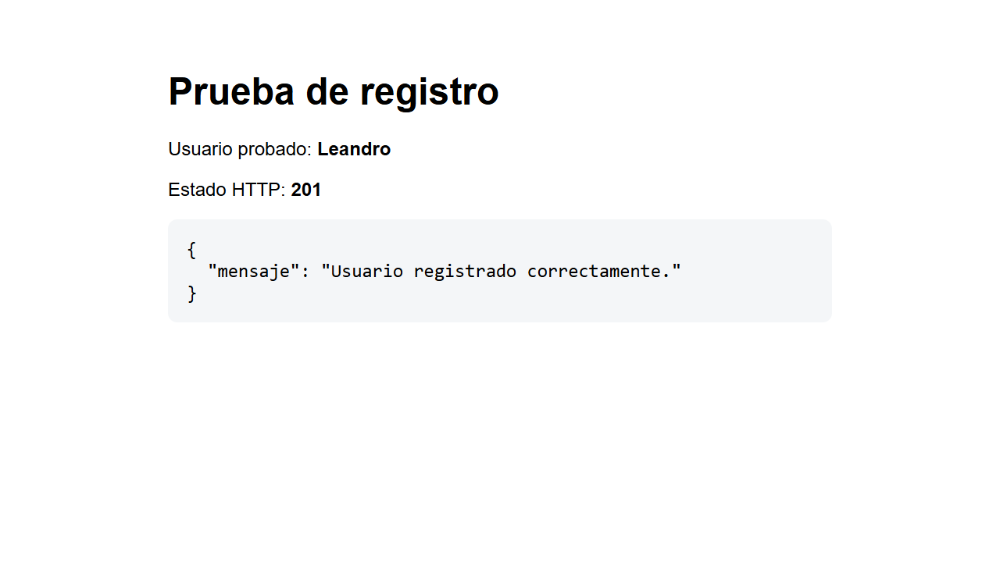
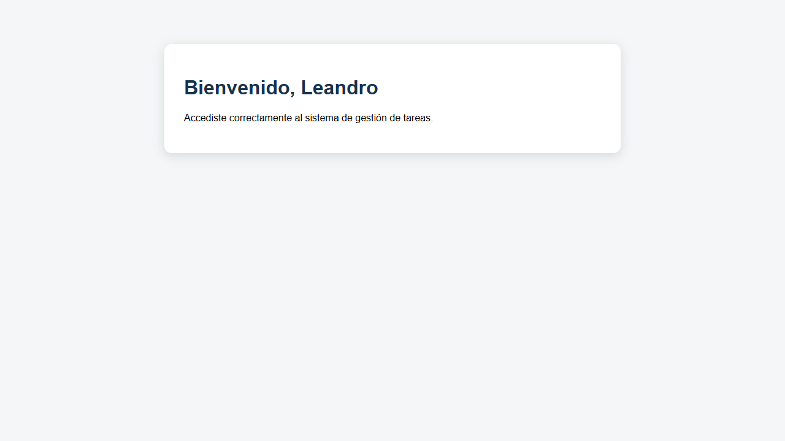

# PFO 2 - Sistema de gestión de tareas

API REST desarrollada con Flask y SQLite. Permite registrar usuarios, iniciar y cerrar sesión, y acceder a una página protegida de tareas. Las contraseñas se almacenan mediante hashes seguros de Werkzeug.

## Requisitos

- Python 3.10 o superior.
- `pip` disponible.

## Instalación

En PowerShell:

```powershell
py -m venv .venv
.\.venv\Scripts\Activate.ps1
py -m pip install -r requirements.txt
```

Para instalar también las dependencias de prueba:

```powershell
py -m pip install -r requirements-dev.txt
```

## Ejecución

Definí una clave de sesión y ejecutá el servidor:

```powershell
$env:SECRET_KEY = "una-clave-local-larga-y-aleatoria"
py servidor.py
```

La API queda disponible en `http://127.0.0.1:5000`. La base `tareas.db` se crea automáticamente y no se versiona.

En otra terminal podés abrir el cliente de consola:

```powershell
.\.venv\Scripts\Activate.ps1
py cliente.py
```

## Endpoints

| Método | Ruta | Descripción |
| --- | --- | --- |
| `POST` | `/registro` | Registra un usuario y guarda su contraseña hasheada. |
| `POST` | `/login` | Verifica las credenciales e inicia una sesión. |
| `POST` | `/logout` | Cierra la sesión actual. |
| `GET` | `/tareas` | Muestra el HTML de bienvenida si hay una sesión válida. |

El registro y el login reciben JSON con este formato:

```json
{
  "usuario": "nombre",
  "contraseña": "1234"
}
```

## Prueba manual con curl

Los siguientes comandos conservan la cookie de sesión en `cookies.txt`:

```powershell
curl.exe -c cookies.txt -H "Content-Type: application/json" -d '{"usuario":"ana","contraseña":"1234"}' http://127.0.0.1:5000/registro
curl.exe -c cookies.txt -b cookies.txt -H "Content-Type: application/json" -d '{"usuario":"ana","contraseña":"1234"}' http://127.0.0.1:5000/login
curl.exe -b cookies.txt http://127.0.0.1:5000/tareas
```

## Pruebas automáticas

```powershell
py -m pytest -v
```

Las pruebas comprueban el hash de contraseñas, los usuarios duplicados, el rechazo de credenciales incorrectas, la protección de `/tareas` y el cierre de sesión.

## Capturas de pruebas

### Registro correcto



### Acceso autenticado a tareas



## Respuestas conceptuales

### ¿Por qué hashear contraseñas?

El hash evita guardar la contraseña original. Si alguien obtiene la base de datos, no encuentra las claves en texto plano. Para validar el acceso se compara la contraseña ingresada con el hash almacenado. Werkzeug aplica un algoritmo lento y sal aleatoria, lo que dificulta ataques por diccionario y evita que dos contraseñas iguales produzcan registros idénticos.

### Ventajas de usar SQLite en este proyecto

SQLite no requiere instalar ni administrar un servidor de base de datos. Guarda la información en un único archivo, viene integrado con Python y ofrece transacciones, restricciones y consultas SQL. Es apropiado para una aplicación de bajo tráfico y permite trasladar o respaldar los datos con facilidad.

## GitHub Pages

La presentación estática del proyecto se encuentra en [`docs/index.html`](docs/index.html). Para publicarla, en la configuración del repositorio se debe seleccionar **Pages**, elegir **Deploy from a branch** y usar la rama `main` con la carpeta `/docs`.

GitHub Pages muestra la documentación y las capturas. El servidor Flask y SQLite se ejecutan localmente porque Pages no admite aplicaciones Python del lado servidor.

